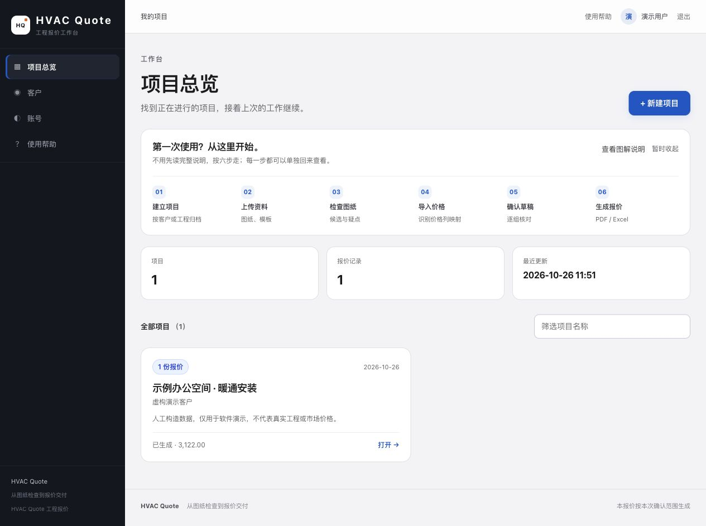
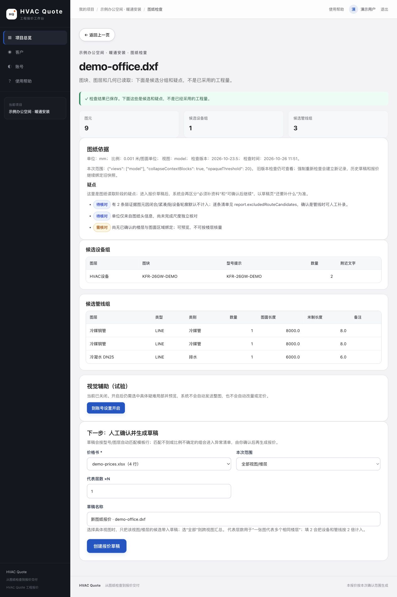
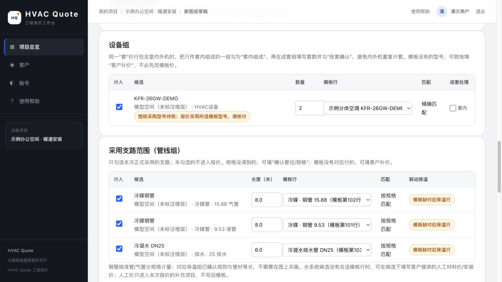
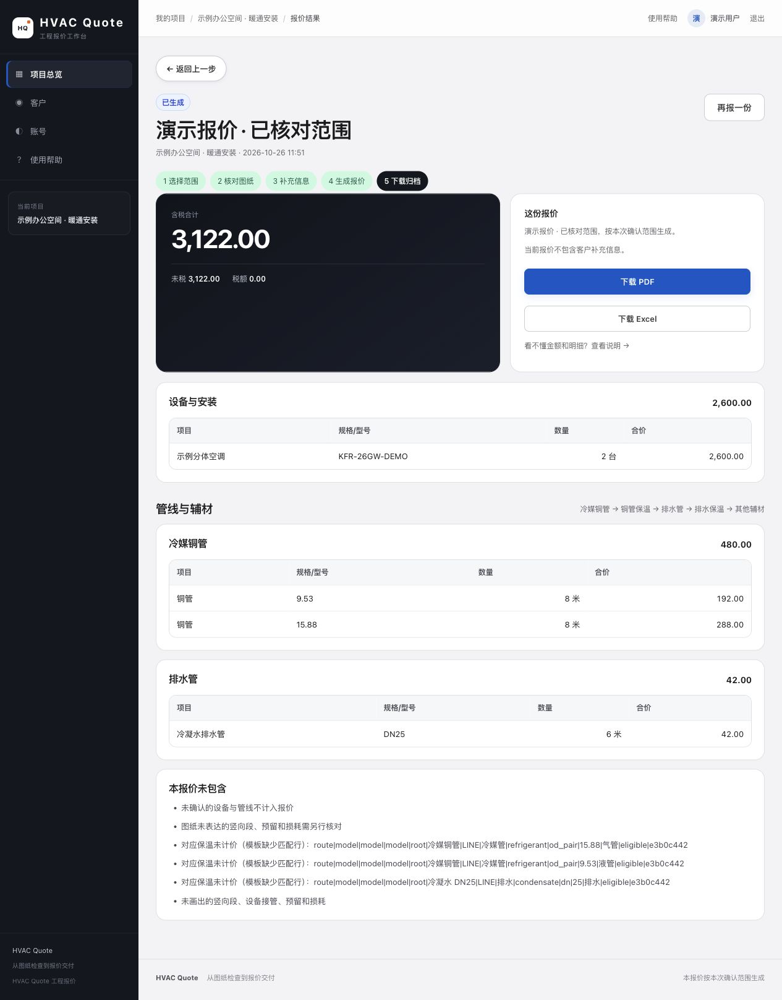

# HVAC Quote

**从 CAD 图纸到可核对的暖通工程报价。**

HVAC Quote（Heating, Ventilation and Air Conditioning Quotation System）是一个可本地运行的暖通工程辅助报价工作台：读取图纸中的设备和管线候选，导入 Excel 价格表，经人工确认后生成报价 Excel 与 PDF。

面向工程流程展示、学习与二次开发。仓库中的演示图纸、客户、数量和价格均为人工构造，不包含真实客户项目。



## 工作流程

```text
建立项目 → 上传 DWG / DXF 与 XLSX → 检查图纸 → 确认价格列
                                             ↓
归档 Excel / PDF ← 生成报价 ← 核对范围、数量、规格、单价和税率
```

- **图纸检查**：读取图块、图层、文字和几何，分组显示设备与管线候选，保留疑点。
- **价格导入**：识别工作表和价格列，支持人工映射；缺价、公式缓存缺失会提示处理。
- **人工核对**：选择计入范围，修正数量、长度和规格，补录缺项，确认成套关系与税率。
- **报价输出**：生成统一格式的 Excel 明细、范围说明及 PDF，核对计算金额与表格重算结果。
- **项目归档**：管理客户、资料、草稿和报价记录；支持项目成员编辑或只读权限。
- **可选视觉辅助**：默认关闭，用于疑难局部的辅助分析，采用结果仍需人工确认。

## 界面预览

以下图片来自本地实际启动的应用，使用同一份合成演示项目；没有替换页面内容或拼接金额。

<details>
<summary>图纸检查：候选设备、管线与待核对问题</summary>



</details>

**数量与价格确认**



<details open>
<summary>报价结果：金额、下载入口与未包含范围</summary>



</details>

截图生成方式见 [界面预览说明](docs/screenshots.md)。

## 本地启动

需要 Python 3.12+ 和 uv。完整报价导出还需要 **LibreOffice** 和中文字体；读取 DWG 额外需要 **LibreDWG 的 `dwg2dxf`**。只体验 DXF 示例时不需要 DWG 转换器。

```bash
git clone https://github.com/supeng0916-beep/hvac-quote.git
cd hvac-quote
uv sync --frozen
uv run hvac-quote serve --data data --runs runs
```

打开 `http://127.0.0.1:8000`，首次使用在页面创建管理员账号。没有内置生产账号或默认密码。

安装依赖、Docker、备份及配置说明见 [运行指南](docs/setup.md)。

### 一键生成合成演示项目

安装好 LibreOffice 和中文字体后，另开终端运行：

```bash
uv run python -m hvac_quote.demo --out data/demo
uv run hvac-quote serve --port 8765 --data data/demo/data --runs data/demo/runs
```

打开 `http://127.0.0.1:8765`，使用命令输出的 `demo` 账号和随机密码登录。生成器会创建新的 DXF、XLSX、数据库和报价文件，并通过真实应用处理链路完成导入与生成。目标目录必须为空；再次体验请指定新目录。

示例包含 2 台设备、两种规格各 8 米铜管和 6 米排水管。材料与安装合计 **3,122.00**，税率为 0。所有价格均为虚构；保温、竖向段、预留和损耗未计入，页面会显示相应提示。演示脚本只针对自己生成的已知几何执行自动确认，不用于确认实际工程图纸。

## 使用边界

- 图纸识别结果是候选。复杂嵌套图块、代理对象、非标准标注、比例或楼层信息不完整时，需要人工核对和补录。
- 价格来自用户导入的价格表或人工补价，系统不提供市场报价。
- 系数默认 1，税率默认 0；生成前按项目约定确认。单侧材料价或安装价缺失时，导入器会按 0 补齐并警告；须人工核对，不能把占位零值当作免费承诺。
- 输出采用公开版统一工作簿格式，**不保留输入模板的原有版式、隐藏表、宏或业务公式**。输入资料保持原样。
- 该版本保留通用流程，移除了专用项目档案、预设工程量、内部商业规则和授权试用机制。首次运行需要自行建立项目。
- 适合本地与受控内网使用。默认仅监听本机；公开 GitHub 仓库不等于部署公共在线报价服务。

更详细的处理范围见 [数据与隐私说明](docs/privacy.md)。

## 技术与验证

Python · FastAPI · SQLite · ezdxf · openpyxl · ReportLab · LibreOffice。页面由服务端 HTML / CSS / JavaScript 渲染，无需 Node.js 构建链。

```bash
uv run pytest -q
uv build
```

测试涵盖账号与项目隔离、候选核对、价格映射、两种税基、Excel/PDF 导出及合成演示全流程。导出相关测试需要 LibreOffice 和中文字体；所有测试使用隔离的临时目录。

```text
src/hvac_quote/   Web 应用、价格与报价流程、合成演示生成器
src/hvac_cad/     CAD 读取与分析工具
tests/           合成数据回归测试
docs/            运行说明、数据边界与真实页面截图
docker/          容器启动入口
```

第三方组件说明见 [THIRD_PARTY.md](THIRD_PARTY.md)。
